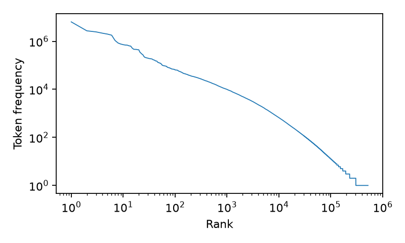
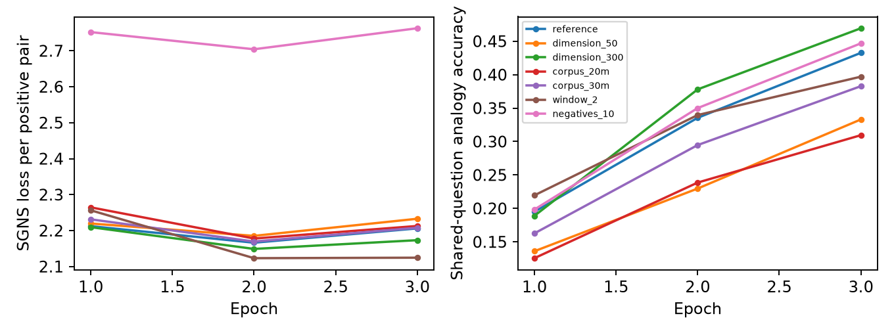
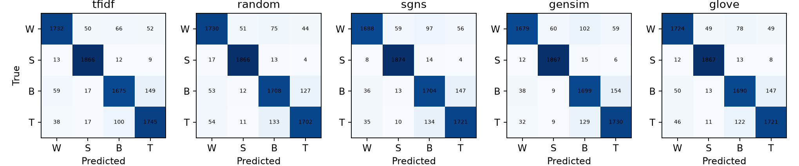
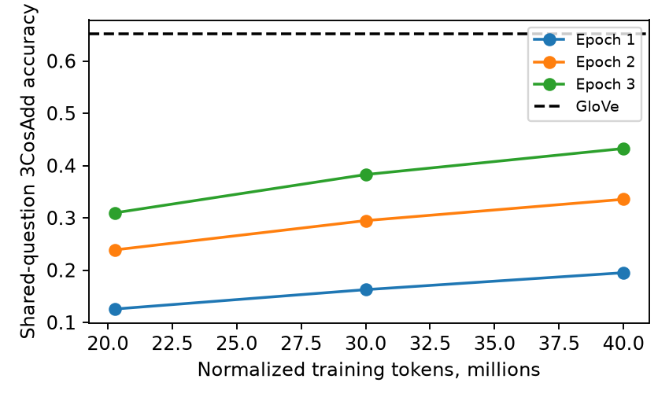
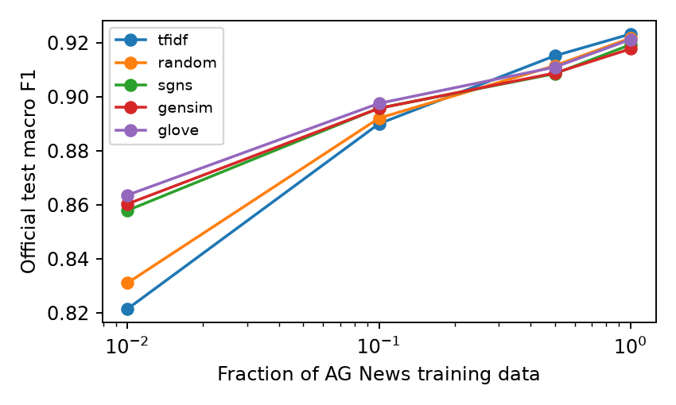

## 1. Research and preprocessing

PyTorch `Embedding` maps IDs to rows through `num_embeddings` and `embedding_dim`.
`padding_idx` reserves an untrained zero row; `sparse=True` saves gradient storage
with a compatible optimizer. `from_pretrained` imports weights and `freeze`
controls adaptation. `EmbeddingBag` uses flattened IDs and offsets for `mean`,
`sum` or `max`; the classifier uses mean. CBOW predicts a center from context;
skip-gram predicts context from a center. SGNS retains separate input and output
tables, exporting input vectors. Word2Vec is predictive; GloVe fits weighted
global log co-occurrences. Gensim uses `sg=1`, `negative`, `sample`, `alpha`,
`epochs` and fixed windows; `KeyedVectors` supports persistence and cosine lookup.

WikiText train contains **29,444 articles, 1,801,350 lines
and 85,929,215 normalized body tokens**. Validation has
182,322 tokens and test
204,879; neither trains embeddings. Article counts
use top-level titles. Headings and standalone punctuation are excluded.
Lowercase words retain apostrophes and numeric strings, repair WikiText markers,
and split hyphens. This matches uncased GloVe without inventing a numeric token.
Sentence splitting remains approximate for abbreviations.

The notebook compares 11 sentences with NLTK Treebank: `can't` stays one word
but Treebank yields `ca` and `n't`; compounds split only in the custom tokenizer;
abbreviations lose dots; numeric separators stay internal. All AG News stages
reuse this exact tokenizer.

| min_count | Vocabulary | Unknown tokens % |
| --- | --- | --- |
| 5 | 80,087 | 1.295 |
| 10 | 54,175 | 2.145 |
| 20 | 36,728 | 3.337 |

The vocabulary is fixed from the 20M subset. Top 10/1,000/30,000 words cover
24.44% / 64.62% /
95.51% of train tokens. The top-30,000 log-log slope
is -1.274: Zipf-like, not an exact slope of −1.
With $t=10^{-4}$, observed discard rates for the/of/and are
96.26% /
94.13% /
93.80%.
This reduces function-word dominance. Fixed-window pairs fall from
337,969,464 to 180,580,964 per epoch
in the 40M subset; contexts never cross sentence boundaries.

{width=65% height=1.55in}

\newpage

## 2. SGNS implementation and controlled iterations

Two sparse embedding tables minimize positive and negative logistic losses.
Noise probability is proportional to frequency raised to 0.75. Batched summed
gradients use SGD, linearly decaying learning rate 0.025 to 0.0001 over three
epochs, `min_count=5`, subsampling $10^{-4}$ and batch size 2,048.
Gensim trains identical encoded sentences, vocabulary and equivalent settings.
It differs through asynchronous online updates and skipped negative collisions.
Loss values across implementations or different negative counts are not directly
comparable.

| Run | M tok | Dim | Win | Neg | Best ep | Loss | Add | WS | Sec | GPU MB |
| --- | --- | --- | --- | --- | --- | --- | --- | --- | --- | --- |
| ref | 40.00 | 100 | 5 | 5 | 3 | 2.206 | 0.433 | 0.681 | 581 | 88 |
| dim50 | 40.00 | 50 | 5 | 5 | 3 | 2.233 | 0.333 | 0.637 | 518 | 54 |
| dim300 | 40.00 | 300 | 5 | 5 | 3 | 2.173 | 0.469 | 0.680 | 450 | 232 |
| 20M | 20.27 | 100 | 5 | 5 | 3 | 2.213 | 0.310 | 0.634 | 191 | 88 |
| 30M | 30.00 | 100 | 5 | 5 | 3 | 2.208 | 0.383 | 0.667 | 269 | 88 |
| win2 | 40.00 | 100 | 2 | 5 | 3 | 2.125 | 0.397 | 0.633 | 154 | 88 |
| neg10 | 40.00 | 100 | 5 | 10 | 3 | 2.763 | 0.447 | 0.668 | 342 | 96 |

Metrics in the table refer to each run's best epoch; time sums all three epochs,
and memory is peak PyTorch allocation, not total GPU process memory.
The notebook retains every epoch's semantic/syntactic/total accuracy,
WordSim-353 Spearman, loss, timings and five neighbors of king, france, computer,
good, january and run.

{width=100% height=2.0in}

The selected model is **dimension_300, epoch 3**.
Selection uses only shared-question 3CosAdd accuracy then WordSim-353.
SimLex and AG News test are held out. Best analogy accuracy for dimensions
50/100/300 is 0.333/0.433/
0.469. For 20M/30M/40M tokens it is
0.310/0.383/0.433.
Window two yields 0.397; ten negatives yield 0.447.
These are descriptive single-seed comparisons, not statistical significance tests.
In the reference run, loss changes from 2.166 at epoch two to 2.206 at epoch three, while analogy accuracy changes from 0.335 to 0.433. A lower negative-sampling loss is not an unconditional
quality guarantee: the objective and benchmarks measure different properties.
Cross-negative-count losses also change their number of terms.

\newpage

## 3. Vector arithmetic, coverage and parallelism

Custom 3CosAdd uses unit source vectors and normalized $b-a+c$, excluding query
words. Its top five match gensim numerically. The notebook evaluates 18 original
analogies across six types, retaining all similarities and correct-answer ranks.
For man → woman, king → queen:

| Model | Top five with cosine | Queen rank | Cosine | First, no exclusion |
| --- | --- | --- | --- | --- |
| sgns | queen 0.58; consort 0.50; coronation 0.49; anointed 0.48; princess 0.48 | 1 | 0.578 | king |
| gensim | queen 0.55; anointed 0.50; electress 0.50; consort 0.50; lfgifu 0.49 | 1 | 0.555 | king |
| glove | queen 0.77; monarch 0.68; throne 0.68; daughter 0.66; princess 0.65 | 1 | 0.770 | king |

Across all original analogies: sgns: 17/18 top-one correct; gensim: 14/18 top-one correct; glove: 17/18 top-one correct.

The benchmark uses the same 30,000 most frequent
shared words. Coverage is
12,322/19,544 questions.
S/G/V denote SGNS/gensim/GloVe. Every category reports evaluated/total:

| Category | Coverage | S Add | G Add | V Add | S Mul | G Mul | V Mul |
| --- | --- | --- | --- | --- | --- | --- | --- |
| capital-common | 420/506 | 0.560 | 0.576 | 0.933 | 0.571 | 0.586 | 0.917 |
| capital-world | 1166/4524 | 0.400 | 0.382 | 0.895 | 0.391 | 0.381 | 0.866 |
| currency | 108/866 | 0.028 | 0.009 | 0.046 | 0.037 | 0.028 | 0.037 |
| city-in-state | 1811/2467 | 0.308 | 0.292 | 0.298 | 0.301 | 0.288 | 0.261 |
| family | 342/506 | 0.670 | 0.696 | 0.883 | 0.635 | 0.681 | 0.874 |
| g1-adjective-to-adverb | 812/992 | 0.151 | 0.148 | 0.278 | 0.132 | 0.134 | 0.280 |
| g2-opposite | 306/812 | 0.190 | 0.170 | 0.281 | 0.147 | 0.131 | 0.245 |
| g3-comparative | 1332/1332 | 0.633 | 0.622 | 0.803 | 0.634 | 0.617 | 0.780 |
| g4-superlative | 702/1122 | 0.330 | 0.318 | 0.613 | 0.358 | 0.363 | 0.618 |
| g5-present-participle | 870/1056 | 0.439 | 0.439 | 0.731 | 0.420 | 0.429 | 0.721 |
| g6-nationality-adjective | 1299/1599 | 0.838 | 0.856 | 0.973 | 0.848 | 0.868 | 0.958 |
| g7-past-tense | 1406/1560 | 0.591 | 0.605 | 0.576 | 0.579 | 0.589 | 0.550 |
| g8-plural | 992/1332 | 0.458 | 0.513 | 0.794 | 0.441 | 0.492 | 0.754 |
| g9-plural-verbs | 756/870 | 0.373 | 0.352 | 0.585 | 0.386 | 0.368 | 0.608 |

The missing section 5.3 is interpreted as cosine parallelism of raw difference
vectors from independent pairs of the same relation. Shared-word comparisons
are excluded. Mean cosine and comparison counts are
sgns: 0.305, 90 comparisons; gensim: 0.297, 90 comparisons; glove: 0.591, 90 comparisons.

The strongest SGNS category is gram6-nationality-adjective at 0.838;
the weakest is currency at 0.028.
Query words can dominate without exclusion, and difference vectors are not
perfectly parallel. Consequently the familiar king−man+woman expression is
approximate retrieval, not equality. A 500-word thematic t-SNE is in the notebook:
technology and countries form recognizable groups, while verbs and animals
overlap more. Neighborhood-based theme selection itself favors visible grouping.

\newpage

## 4. End-to-end AG News classification

The official 120,000 training documents split into 108,000 train and 12,000
stratified validation documents. TF-IDF fits train only. Mean EmbeddingBag feeds
a 128-unit ReLU/dropout MLP; missing words map to ignored padding, with a zero
representation for all-unknown documents. Two learning rates and validation
macro F1 select epochs and frozen/fine-tuned variants. TF-IDF tunes two values
of C using warm-start logistic regression; its loss curve uses optimizer blocks.
The selected SGNS/gensim dimension differs from GloVe's 100D; classification differences therefore include a dimension confound. Random vectors match SGNS.

Validation results below select the better learning rate within each variant.
P/R/F denotes macro precision/recall/F1; parameter counts are in millions and
include embedding rows. Exact counts remain in the notebook and CSV.

| Initialization | Variant | Acc | P/R/F | Total/trainable M | Seconds |
| --- | --- | --- | --- | --- | --- |
| tfidf | logistic | 0.921 | 0.921/0.921/0.921 | 0.400/0.400 | 39.6 |
| random | trainable | 0.920 | 0.920/0.920/0.920 | 19.639/19.639 | 24.1 |
| sgns | frozen | 0.895 | 0.896/0.895/0.895 | 24.065/0.039 | 14.6 |
| sgns | finetuned | 0.916 | 0.917/0.916/0.916 | 24.065/24.065 | 22.5 |
| gensim | frozen | 0.892 | 0.893/0.892/0.892 | 24.065/0.039 | 15.2 |
| gensim | finetuned | 0.916 | 0.917/0.916/0.916 | 24.065/24.065 | 23.5 |
| glove | frozen | 0.903 | 0.904/0.903/0.903 | 40.014/0.013 | 14.4 |
| glove | finetuned | 0.920 | 0.921/0.920/0.920 | 40.014/40.014 | 69.9 |

The best initialization-specific configuration is selected on validation before
official test. Every selected fraction/configuration receives one cached test
evaluation. No test score changes model settings.

| Initialization | 100% variant | Test accuracy | Test F1, 100% | Test F1, 1% |
| --- | --- | --- | --- | --- |
| tfidf | logistic | 0.923 | 0.923 | 0.821 |
| random | trainable | 0.922 | 0.922 | 0.831 |
| sgns | finetuned | 0.919 | 0.919 | 0.858 |
| gensim | finetuned | 0.918 | 0.918 | 0.860 |
| glove | finetuned | 0.921 | 0.921 | 0.864 |

{width=100% height=1.55in}

Variant selections: sgns: finetuned at 100%, finetuned at 1%; gensim: finetuned at 100%, finetuned at 1%; glove: finetuned at 100%, finetuned at 1%.
The highest full-data test F1 belongs to tfidf at 0.923.
The 1% experiment contains 1,080 training documents, with validation unchanged.
Fine-tuning wins validation selection at all four fractions; freezing reduces
trainable parameters but never gives the best F1 here. Pretrained vectors do
not beat TF-IDF or random vectors at full data, but all three improve over both
at 1%. The narrow full-data margins do not establish statistical superiority.

\newpage

## 5. Comparison, data efficiency and conclusions

| Model | Tokens | Vocabulary | Dim | Train sec | WordSim | SimLex |
| --- | --- | --- | --- | --- | --- | --- |
| sgns | 40,000,011 | 80,087 | 300 | 450.1 | 0.680 | 0.330 |
| gensim | 40,000,011 | 80,087 | 300 | 209.9 | 0.680 | 0.337 |
| glove | 6,000,000,000 | 400,000 | 100 | NR | 0.533 | 0.298 |

| Model | Add S/T/all | Mul S/T/all | Parallelism | AG OOV % | Test F1 |
| --- | --- | --- | --- | --- | --- |
| sgns | 0.388/0.507/0.469 | 0.380/0.502/0.464 | 0.305 | 3.661 | 0.919 |
| gensim | 0.378/0.512/0.470 | 0.376/0.510/0.468 | 0.297 | 3.661 | 0.918 |
| glove | 0.593/0.679/0.652 | 0.564/0.664/0.633 | 0.591 | 1.044 | 0.921 |

S/T denotes semantic/syntactic. SGNS uses the RTX 4050 Laptop 6 GB; gensim uses
four CPU workers. The authors report the GloVe corpus as 6B tokens and 400,000
words. Exact released-100D wall time and CPU model are not specified; NR is
preferable to substituting a different-dimensional timing example.
Similarity coverage is retained in the accompanying comparison CSV and notebook.

{width=72% height=1.55in}

{width=72% height=1.55in}

SGNS semantic/syntactic accuracy is 0.388/0.507. The overall GloVe minus SGNS gap is +0.183; gensim minus SGNS is +0.001. At epoch three, window 2 versus 5 changes semantic accuracy from 0.339 to 0.247 and syntactic accuracy from 0.475 to 0.465. Ten versus five negatives changes overall accuracy from 0.433 to 0.447.

The corpus-size experiment measures a within-SGNS scaling trend, not a causal
decomposition of the GloVe gap. GloVe differs in corpus composition, tokenization,
objective and training budget. Small windows reduce semantic accuracy more than
syntactic accuracy here, but do not improve absolute syntactic accuracy. More
negatives improve overall accuracy under the measured budget, not necessarily
every category. Gensim discrepancies remain consistent
with the documented optimization differences rather than proof that either
objective is implemented incorrectly. Single-seed results, approximate sentence
splitting and fixed vocabulary limit generalization.

**Sources:** Mikolov et al. 2013, arXiv:1310.4546; Pennington et al. 2014,
EMNLP, nlp.stanford.edu/pubs/glove.pdf; Stanford original GloVe release;
PyTorch Embedding/EmbeddingBag and gensim Word2Vec documentation.
Full links and API research are in `research.md` and the notebook.
Best original vectors: `informe/artifacts/best_sgns.kv`.
